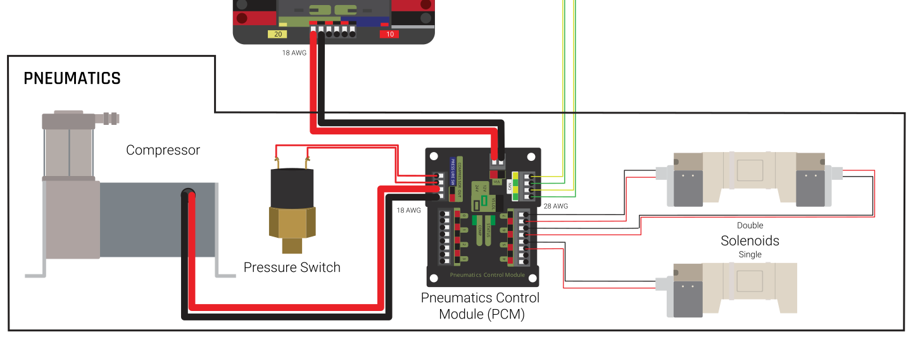

Wiring Pneumatics - CTRE Pneumatic Control Module
=================================================

The Pneumatics Control Module (PCM) connects the compressor, pressure switch,
and solenoid valves. For the REV Pneumatic Hub, use :doc:`wiring-pneumatics-ph`.

Disconnect the battery before changing connections. Follow the
`CTRE PCM User's Guide
<https://ctre.download/files/user-manual/PCM%20User%27s%20Guide.pdf>`_
for terminal identification, wire sizes, and electrical limits. Use the current
season rules for pneumatic system requirements.

Component Connections
---------------------

   PCM component connections.

Use the module labels to identify power, compressor, pressure-switch, and
solenoid terminals. Record the PCM CAN ID and solenoid channel assignments
with the robot's wiring notes.

Compressor
----------

Connect the compressor leads to the PCM's ``COMPRESSOR OUT`` terminals,
matching the terminal polarity. Use the wire and connector requirements in
the PCM and compressor documentation.

Pressure Switch
---------------

Connect the digital pressure switch to ``PRESSURE SW``. The switch connection
has no polarity. Check that both wires are secured in their terminals and
that the switch connections are supported.

Solenoids
---------

Connect each solenoid coil to a numbered output pair, matching the marked
positive and negative terminals. A single-solenoid valve uses one channel;
a double-solenoid valve uses two. Record the channel numbers for the program.

Solenoid Voltage
----------------

.. figure:: images/wiring-pneumatics-pcm/pcm-jumper.svg
   :alt: PCM showing the VSOL jumper and its labeled 12V and 24V positions.
   :width: 450

   Solenoid voltage selection.

Set the ``VSOL`` jumper to match the solenoid voltage before connecting power.
All solenoids on a PCM use the selected voltage. Follow the markings on the
module and the CTRE guide when positioning the jumper.

Systemcore Power and CAN
------------------------

For Systemcore integration, continue to the
`Systemcore wiring guide in WPILib
<{{ wpilib_docs_url }}docs/zero-to-robot/systemcore-wiring.html>`_ and
`Systemcore CAN Wiring
<{{ wpilib_docs_url }}docs/software/systemcore-info/systemcore-can-wiring.html>`_.
Use the PCM and power distribution documentation for the module's supply
connection. Systemcore-specific connection details remain in WPILib.

Before Testing
--------------

Check wiring against the component labels, confirm the solenoid voltage,
and complete the :doc:`physical inspection checklist
<preemptive-troubleshooting>` before powered tests.

For code, use the `WPILib PCM guide
<{{ wpilib_docs_url }}docs/software/can-devices/pneumatics-control-module.html>`_.
For module diagnostics, see `CTRE PCM bring-up
<https://v5.docs.ctr-electronics.com/en/stable/ch09_BringUpPCM.html>`_.
