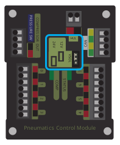

Wiring Pneumatics - CTRE Pneumatic Control Module
=================================================

This page describes wiring pneumatics with the CTRE Pneumatic Control Module (PCM). For instructions on wiring pneumatics with the REV Pneumatic Hub (PH) see :doc:`this page <wiring-pneumatics-ph>`.

.. hint:: For pneumatics safety & mechanical requirements, consult this year's Robot Construction rules. For mechanical design guidelines, refer to the `FIRST Pneumatics Manual <https://info.firstinspires.org/hubfs/web/program/frc/resources/pneumatics-manual.pdf>`__.

.. seealso:: For Pneumatic Control Module configuration and firmware updates using Phoenix Tuner, see the CTRE documentation:

   - `CAN Bus Setup <https://v5.docs.ctr-electronics.com/en/stable/ch08_BringUpCAN.html>`__ - Device IDs, firmware updates, and troubleshooting
   - `PCM Bring-Up <https://v5.docs.ctr-electronics.com/en/stable/ch09_BringUpPCM.html>`__ - Testing solenoids and compressor operation

Wiring Overview
---------------

For complicated robot designs requiring more channels or multiple solenoid voltages, additional PCMs, or PHs can be added to the control system.

PCM Power and Control Wiring
----------------------------

.. image:: images/wiring-pneumatics-pcm/pcm-subsystem.svg
   :alt: Pneumatics wiring diagram showing all of the connections to the PCM.

Additional PCMs can be wired to a standard WAGO connector on the side of the PDP and protected with a 20A or smaller circuit breaker. Additional PCMs should also be placed anywhere in the middle of the CAN chain.

The Compressor
--------------

The compressor can be wired directly to the Compressor Out connectors on the PCM. If additional length is required, make sure to use 18 AWG wire or larger for the extension.

The Pressure Switch
-------------------

The pressure switch should be connected directly to the pressure switch input terminals on the PCM. There is no polarity on the input terminals or on the pressure switch itself, either terminal on the PCM can be connected to either terminal on the switch. Ring or spade terminals are recommended for the connection to the switch screws (note that the screws are slightly larger than #6, but can be threaded through a ring terminal with a hole for a #6 screw such as the terminals shown in the image).

Solenoids
---------

Each solenoid channel should be wired directly to a numbered pair of terminals on the PCM. A single acting solenoid will use one numbered terminal pair. A double acting solenoid will use two pairs. If your solenoid does not come with color coded wiring, check the datasheet to make sure to wire with the proper polarity.

Solenoid Voltage Jumper
-----------------------

The PCM is capable of powering either 12V or 24V solenoids, but all solenoids connected to a single PCM must be the same voltage. The PCM ships with the jumper in the 12V position as shown in the image. To use 24V solenoids move the jumper from the left two pins (as shown in the image) to the right two pins. The overlay on the PCM also indicates which position corresponds to which voltage. You may need to use a tool such as a small screwdriver, small pair of pliers, or a pair of tweezers to remove the jumper.

.. note:: Systemcore scope

   The wording above is retained from the upstream article. Controller-specific
   material and illustrations that do not apply to this site's Systemcore scope
   are excluded rather than relabeled. Use the
   `Systemcore wiring guide <{{ wpilib_docs_url }}docs/zero-to-robot/systemcore-wiring.html>`_
   for the installed revision's connection requirements.

Source: `WPILib upstream, 2f175339
<https://github.com/wpilibsuite/wpilib-docs/blob/2f175339ca2f66bdd8b733eb5832d9ab9291f1c1/source/docs/hardware/hardware-basics/wiring-pneumatics-pcm.rst>`_,
`CC BY 4.0 <https://creativecommons.org/licenses/by/4.0/>`__.
