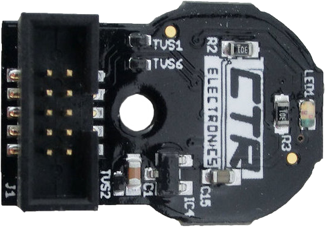

Encoders - Hardware
===================

Encoders measure shaft position or movement. Use them to track a wheel,
arm, elevator, or other mechanism. Some motors already include an encoder.

Mounting Options
----------------

* **Shafted:** the encoder has its own shaft, coupled to the mechanism.
* **Through-bore or on-shaft:** the mechanism shaft passes through the encoder.
* **Magnetic:** a magnet rotates with the shaft while the sensor stays fixed.

   Magnetic encoder.

Follow the sensor's mounting instructions for alignment, spacing, and support.
A loose coupling or misaligned magnet can make the measurement unreliable.

Signals and Position
--------------------

Quadrature encoders use two pulse signals to measure movement and direction.
Absolute encoders report position within their measurement range. Depending
on the device, an absolute reading may use duty cycle, analog voltage, or a
communication bus. Check the output type before choosing an input.

:doc:`Digital inputs <digital-inputs-hardware>`,
:doc:`analog inputs <analog-inputs-hardware>`, and
:doc:`serial buses <serial-buses>` describe the interface choices.

Systemcore Connections
----------------------

Use `Systemcore wiring in WPILib <{{ wpilib_docs_url }}docs/zero-to-robot/systemcore-wiring.html#sensor-connections>`_
for controller connections. Check the sensor's electrical interface and the
controller hardware revision before wiring.

For code, use the `WPILib sensor guide
<{{ wpilib_docs_url }}docs/software/hardware-apis/sensors/encoders-software.html>`_.
