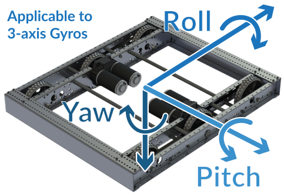

.. include:: <isonum.txt>

Gyroscopes - Hardware
=====================

.. note:: This section covers gyro hardware.  For a software guide to gyros, see `Gyroscopes - Software <{{ wpilib_docs_url }}docs/software/hardware-apis/sensors/gyros-software.html#gyroscopes-software>`__.

Gyroscopes (or "gyros", for short) are devices that measure rate-of-rotation.  These are particularly useful for stabilizing robot driving, or for measuring heading or tilt by integrating (adding-up) the rate measurements to get a measurement of total angular displacement.

Several popular FRC\ |reg| devices known as :ref:`IMUs <docs/hardware/sensors/accelerometers-hardware:IMUs (Inertial Measurement Units)>` (Inertial Measurement Units) combine 3-axis gyros, accelerometers, and other position sensors into one device. Some  popular examples are:

The most common type of Gyros used in FRC are three-axis gyros, commonly included in IMUs.

Three-axis gyros measure rotation rate around all three spatial axes (typically labeled x, y, and z). The motion around these axis is called pitch, yaw, and roll.

.. note:: The coordinate system shown above is often used for three axis gyros, as it is a convention in avionics. Note that other coordinate systems are used in mathematics and referenced throughout WPILib. Please refer to the `Drive class axis diagram <{{ wpilib_docs_url }}docs/software/hardware-apis/motors/wpi-drive-classes.html#axis-conventions>`__ for axis referenced in software.

Peripheral three-axis gyros typically communicate over the :ref:`CAN Bus <docs/hardware/sensors/serial-buses:CAN Bus>` to send data.

.. note:: Systemcore scope

   The wording above is retained from the upstream article. Controller-specific
   material and illustrations that do not apply to this site's Systemcore scope
   are excluded rather than relabeled. Use the
   `Systemcore wiring guide <{{ wpilib_docs_url }}docs/zero-to-robot/systemcore-wiring.html>`_
   for the installed revision's connection requirements.

Source: `WPILib upstream, 2f175339
<https://github.com/wpilibsuite/wpilib-docs/blob/2f175339ca2f66bdd8b733eb5832d9ab9291f1c1/source/docs/hardware/sensors/gyros-hardware.rst>`_,
`CC BY 4.0 <https://creativecommons.org/licenses/by/4.0/>`__.
