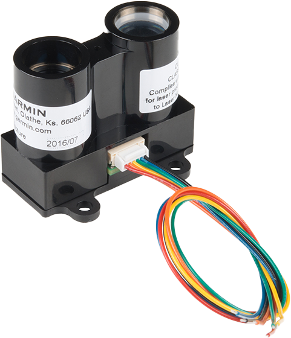
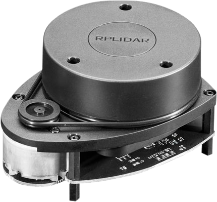

Lidar - Hardware
================

Lidar uses emitted light and its return to measure distance. The measurement
can help detect objects or map the area around a robot.

Single-direction Sensors
------------------------

   Single-direction lidar sensor.

A single-direction sensor measures along its beam. Check its minimum and
maximum range, field of view, update rate, and communication interface.

Scanning Sensors
----------------

   Scanning lidar sensor.

A scanning sensor collects measurements across a plane. The program must
handle a set of range readings rather than one distance. Check the scan rate,
angular resolution, and available software support.

Choosing a Target
-----------------

Reflectivity, transparent surfaces, target angle, and distance can affect the
reading. Test with the actual objects you want to detect. More distant targets
also have wider spacing between samples at a fixed angular resolution.

See :doc:`serial-buses` for communication choices.

Systemcore Connections
----------------------

.. note::

   Systemcore connection diagrams for these sensors are still being completed.
   Check the sensor supply, signal levels, pinout, and interface against the
   controller documentation before wiring.

For code, use the `WPILib sensor guide
<https://docs.wpilib.org/en/latest/docs/software/hardware-apis/sensors/sensor-overview-software.html>`_.
