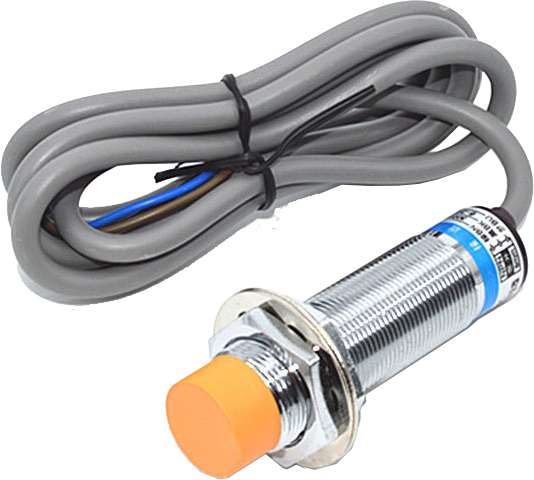

Proximity Switches - Hardware
=============================

Proximity sensors detect a mechanism or object at a known location. They are
often used as limit switches or to detect a game piece.

Mechanical Limit Switches
-------------------------

A limit switch changes state when an object moves its arm or plunger. Place
it where it can be activated reliably without being crushed by the mechanism.

Check whether the selected contacts are normally open or normally closed.
The code must account for that choice and for what happens if a wire breaks.
Do not assume that every controller reads an open switch the same way.

No-contact Sensors
------------------

* **Magnetic:** detects a magnet near the sensor; mounting position matters.
* **Inductive:** detects a nearby conductive target.
* **Photoelectric:** uses reflected light or a separate beam-break emitter
  and receiver to detect an object.

   Inductive proximity sensor.

Check the sensing distance and output type. Reflective sensors can respond
differently to different target materials and angles. A powered proximity
sensor may need a different supply or signal interface from a simple switch.
See :doc:`digital-inputs-hardware`.

Systemcore Connections
----------------------

Use `Systemcore wiring in WPILib <{{ wpilib_docs_url }}docs/zero-to-robot/systemcore-wiring.html#sensor-connections>`_
for controller connections. Check the sensor's electrical interface and the
controller hardware revision before wiring.

For code, use the `WPILib sensor guide
<{{ wpilib_docs_url }}docs/software/hardware-apis/sensors/digital-inputs-software.html>`_.
