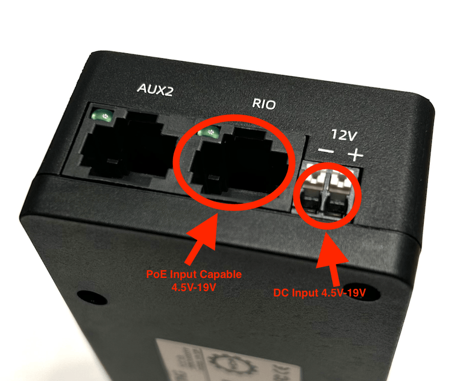
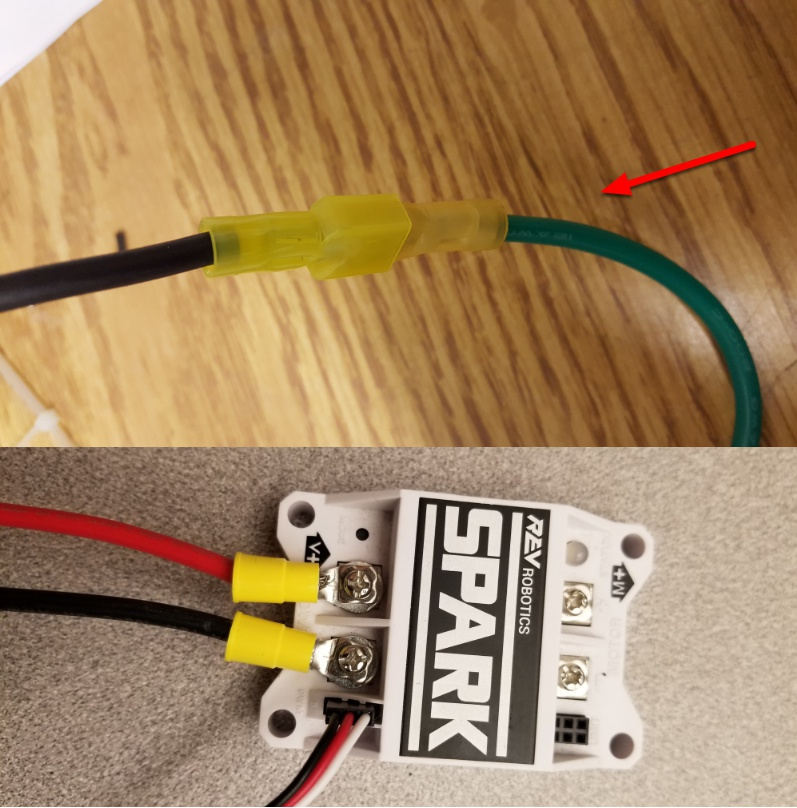

.. include:: <isonum.txt>

Introduction to FRC Robot Wiring
================================

.. note::

   This document details the wiring of a basic electronics board for the kitbot or to allow basic drivetrain testing.

   Some images shown in this section reflect the setup for a Robot Control System using SPARK or SPARK MAX Motor Controllers. Wiring diagram and layout should be similar for other motor controllers. Where appropriate, two sets of images are provided to show connections using controllers with and without integrated wires.

Overview
--------

Gather Materials
----------------

Locate the following control system components and tools

- Tools Required:
      - Wago Tool or small flat-head screwdriver
      - Very small flat head screwdriver (eyeglass repair size)
      - Wire cutters, strippers, and crimpers
      - 7/16" (11 mm may work if imperial is unavailable) box end wrench or nut driver
      - Additional 7/16" wrench/nut driver or Philips head screw driver
      - For CTR PDP only: 5 mm Hex key (3/16" may work if metric is unavailable)
      - For CTR PDP only: 1/16" Hex key

Create the Base for the Control System
--------------------------------------

For a test board, cut piece of 1/4" or 1/2" (6-12 mm) material (wood or plastic) approximately 24" x 16" (60 x 40 cm). For a Robot Quick Build control board see the supporting documentation for the proper size board for the chosen chassis configuration.

Layout the Core Control System Components
-----------------------------------------

Lay out the components on the board. An example layout is shown in the image above.

.. note:: A Vivid-Hosting has a `guide <https://frc-radio.vivid-hosting.net/getting-started/usage/mounting-your-radio>`__ for mounting the VH-109 radio.

Fasten Components
-----------------

Using the Dual Lock or hardware, fasten all components to the board. Note that in many FRC games robot-to-robot contact may be substantial and Dual Lock alone is unlikely to stand up as a fastener for many electronic components. Teams may wish to use nut and bolt fasteners or (as shown in the image above) cable ties, with or without Dual Lock to secure devices to the board.

Attach Robot Side Battery Connector
-----------------------------------

.. tab-set::

   .. tab-item:: REV
      :sync: REV

      The next step will involve using the Wago connectors on the PDH. To use the Wago connectors, open the lever, insert the wire, then close the lever. Two sizes of Wago connector are found on the PDH:

      - Main power connectors: Accept 4 - 18 AWG (.75 - 25 :math:`mm^2`), strip 20 mm (~3/4")
      - High current channel connectors: Accept 8 - 24 AWG (.25 - 10 :math:`mm^2`), strip 12 mm (~1/2")

      To maximize pullout force and minimize connection resistance wires should not be tinned (and ideally not twisted) before inserting into the Wago connector.

      .. image:: images/how-to-wire-a-simple-robot/terminal-lug-REV.jpg
        :alt: Highlights the location of the terminal lugs on the PDH and circuit breaker.

      Requires: Battery Connector, 6 AWG (16 :math:`mm^2`) terminal lugs, 7/16" (11 mm) Box end

      Attach terminal lug to positive (red) wire of battery connector. Strip .75" off the black wire.

      Lift the lever above the black main power input terminal on the PDH until it clicks into place. Insert the wire. Pull the lever down to secure the wire.

      Using a 7/16" (11 mm) box end wrench, remove the nut on the "Batt" side of the main breaker and secure the positive terminal of the battery connector

   .. tab-item:: CTR
      :sync: CTR

      .. image:: images/how-to-wire-a-simple-robot/terminal-lug.jpg
        :alt: Highlights the location of the terminal lugs on the PDP and circuit breaker.

      Requires: Battery Connector, 6 AWG (16 :math:`mm^2`) terminal lugs, 1/16" Allen, 5 mm Allen,
      7/16" (11 mm) Box end

      Attach terminal lugs to battery connector.

      1. Using a 1/16" Allen wrench, remove the two screws securing the PDP terminal cover.
      2. Using a 5 mm Allen wrench (3/16"), remove the negative (-) bolt and washer from the PDP and fasten the negative terminal of the battery connector.
      3. Using a 7/16" (11 mm) box end wrench, remove the nut on the "Batt" side of the main breaker and secure the positive terminal of the battery connector

Wire Breaker to Power Distribution
----------------------------------

.. tab-set::

   .. tab-item:: REV
      :sync: REV

      .. image:: images/how-to-wire-a-simple-robot/circuit-breaker-REV.jpg
        :alt: Show the circuit breaker wired to the PDH.

      Requires: 6 AWG (16 :math:`mm^2`) red wire, 1x 6 AWG (16 :math:`mm^2`) terminal lugs, 7/16" (11 mm) wrench

      Secure one terminal lug to the end of the 6 AWG (16 :math:`mm^2`) red wire. Using the 7/16" (11 mm) wrench, remove the nut from the "AUX" side of the 120A main breaker and place the terminal over the stud. Loosely secure the nut (you may wish to remove it shortly to cut and strip the other end of the wire). Measure out the length of wire required to reach the positive terminal of the PDH.

      1. Cut and strip the other end of the red wire.
      2. Using the 7/16" (11 mm) wrench, secure the wire to the "AUX" side of the 120A main breaker.
      3. Lift the lever on the positive (red) input terminal of the PDH, insert the wire, then close the terminal.

   .. tab-item:: CTR
      :sync: CTR

      .. image:: images/how-to-wire-a-simple-robot/circuit-breaker.jpg
        :alt: Show the circuit breaker wired to the PDP.

      Requires: 6 AWG (16 :math:`mm^2`) red wire, 2x 6 AWG (16 :math:`mm^2`) terminal lugs, 5 mm Allen, 7/16" (11 mm) box end

      Secure one terminal lug to the end of the 6 AWG (16 :math:`mm^2`) red wire. Using the 7/16" (11 mm) box end, remove the nut from the "AUX" side of the 120A main breaker and place the terminal over the stud. Loosely secure the nut (you may wish to remove it shortly to cut, strip, and crimp the other end of the wire). Measure out the length of wire required to reach the positive terminal of the PDP.

      1. Cut, strip, and crimp the terminal to the 2nd end of the red 6 AWG (16 :math:`mm^2`) wire.
      2. Using the 7/16" (11 mm) box end, secure the wire to the "AUX" side of the 120A main breaker.
      3. Using the 5 mm Allen wrench, secure the other end to the PDP positive terminal.

Insulate power connections
--------------------------

.. tab-set::

   .. tab-item:: REV
      :sync: REV

      .. image:: images/how-to-wire-a-simple-robot/insulate-REV.jpg
        :alt: Putting tape around the connectors to insulate them.

      Requires: Electrical tape

      Using electrical tape, insulate the two connections to the 120A breaker.

   .. tab-item:: CTR
      :sync: CTR

      .. image:: images/how-to-wire-a-simple-robot/insulate.jpg
        :alt: Putting tape around the connectors to insulate them.

      Requires: 1/16" Allen, Electrical tape

      1. Using electrical tape, insulate the two connections to the 120A breaker. Also insulate any part of the PDP terminals which will be exposed when the cover is replaced.
      2. Using the 1/16" Allen wrench, replace the PDP terminal cover

Motor Controller Power
----------------------

Weidmuller Connectors
---------------------

A number of the CAN and power connectors in the system use a Weidmuller LSF series wire-to-board connector. There are a few things to keep in mind when using this connector for best results:

- Wire should be 16 AWG (1.5 :math:`mm^2`) to 24 AWG (0.25 :math:`mm^2`) (consult rules to verify required gauge for power wiring)
- Wire ends should be stripped approximately 5/16 (~8 mm)"
- A ferrule can be added to reinforce the connection and prevent splaying, as shown in the video above.
- To insert or remove the wire, press down on the corresponding "button" to open the terminal

After making the connection check to be sure that it is clean and secure:

- Verify that there are no "whiskers" outside the connector that may cause a short circuit
- Tug on the wire to verify that it is seated fully. If the wire comes out and is the correct gauge it needs to be inserted further and/or stripped back further. Occasionally the terminal may remain stuck open with the wire inserted and the button released even if the wire is stripped and inserted properly; in these cases wiggling the wire in and out a small amount will often allow the connector to latch shut and grip the wire.

Radio Power
-----------

`Vivid-Hosting Wiring Guide <https://frc-radio.vivid-hosting.net/getting-started/usage/wiring-your-radio>`__

.. tab-set::

   .. tab-item:: REV
      :sync: REV

      .. image:: images/how-to-wire-a-simple-robot/pdh-power.jpg
        :alt: Power coming from a PDH non-switchable fused channel.

      Requires: Wire stripper, small flat screwdriver (optional), 18 AWG (1 :math:`mm^2`) red and black wire:

      1. Insert the 10A fuse into the PDH in one of the non-switchable fused channels (20-22).
      2. Strip ~5/16" (~8 mm) on the end of the red and black 18 AWG (1 :math:`mm^2`) wire and connect the wire to the corresponding terminals on the PDH.

   .. tab-item:: CTR
      :sync: CTR

      .. image:: images/how-to-wire-a-simple-robot/pdp-radio-power.jpg
        :alt: Power going from the PDP "Vbat VRM PCM PWR" terminals.

      Requires: Wire stripper, small flat screwdriver (optional), 18 AWG (1 :math:`mm^2`) red and black wire:

      1. Strip ~5/16" (~8 mm) on the end of the red and black 18 AWG (1 :math:`mm^2`) wire.
      2. Connect the wire to one of the two terminal pairs labeled "Vbat VRM PCM PWR" on the PDP.

3. Measure the length required to reach the "12V" Weidmuller terminals on the VH-109 Radio. Take care to leave enough length to route the wires around any other components such as the battery and to allow for any strain relief or cable management.
4. Cut and strip ~5/16" (~8 mm) from the end of the wire.
5. Connect the wire to the VH-109 "12V" Weidmuller terminals.

.. note:: The radio can additionally be powered by :external+wpilib:term:`PoE` to create a more redundant connection.

Pneumatics Power (Optional)
---------------------------

.. tab-set::

   .. tab-item:: REV
      :sync: REV

      .. image:: images/how-to-wire-a-simple-robot/ph-pdh-power.jpg
        :alt: Power going from the PDH to the PH.

      .. image:: images/how-to-wire-a-simple-robot/ph.jpg
        :alt: Power going into the PH.

      Requires: Wire stripper, small flat screwdriver (optional), 18 AWG (1 :math:`mm^2`) red and black wire

      .. note:: The Pneumatics Hub is an optional component used for controlling pneumatics on the robot.

      The Pneumatics Hub can be wired to either a non-switchable fused port on the PDH with a 15A or smaller fuse or to a circuit breaker protected port with a breaker up to 20A.

      1. Strip ~5/16" (~8 mm) on the end of the red and black 18 AWG (1 :math:`mm^2`) wire.
      2. Connect the wire to the PDH in one of the two ways described above
      3. Measure the length required to reach the red terminals on the short end of the PH labeled +/-. Take care to leave enough length to route the wires around any other components such as the battery and to allow for any strain relief or cable management.
      4. Cut and strip ~5/16" (~8 mm) from the other end of the wire.
      5. Connect the wire to the PH input terminals.

   .. tab-item:: CTR
      :sync: CTR

      .. image:: images/how-to-wire-a-simple-robot/pcm-power.jpg
        :alt: Power going from the PDP to the PCM.

      Requires: Wire stripper, small flat screwdriver (optional), 18 AWG (1 :math:`mm^2`) red and black wire

      .. note:: The PCM is an optional component used for controlling pneumatics on the robot.

      1. Strip ~5/16" (~8 mm) on the end of the red and black 18 AWG (1 :math:`mm^2`) wire.
      2. Connect the wire to one of the two terminal pairs labeled "Vbat VRM PCM PWR" on the PDP.
      3. Measure the length required to reach the "Vin" terminals on the PCM. Take care to leave enough length to route the wires around any other components such as the battery and to allow for any strain relief or cable management.
      4. Cut and strip ~5/16" (~8 mm) from the end of the wire.
      5. Connect the wire to the PCM 12Vin terminals.

Ethernet Cables
---------------

Requires: an Ethernet cable

.. note:: If using :external+wpilib:term:`PoE` you may need a second Ethernet cable or longer power wires.

CAN Devices
-----------

Pneumatics to PD CAN
~~~~~~~~~~~~~~~~~~~~

Motor Controller Signal Wires
-----------------------------

Robot Signal Light
------------------

Requires: Wire stripper, 2 pin cable, Robot Signal Light, 18 AWG (1 :math:`mm^2`) red wire, very small flat screwdriver

.. tip:: You may wish to temporarily secure the RSL to the control board using cable ties or Dual Lock (it is recommended to move the RSL to a more visible location as the robot is being constructed)

Circuit Breakers
----------------

.. tab-set ::

   .. tab-item:: REV
      :sync: REV

      .. image:: images/how-to-wire-a-simple-robot/40A-breaker-REV.jpg
        :alt: Installing 40A breakers in the PDP.

      Requires: 4x 40A circuit breakers

      Insert 40-amp Circuit Breakers into the positions on the PDH corresponding with the Wago connectors the motor controllers are connected to. Note that the white graphic indicates which breakers are associated with which terminal pairs.

      If working on a Robot Quick Build, stop here and insert the board into the robot chassis before continuing.

   .. tab-item:: CTR
      :sync: CTR

      .. image:: images/how-to-wire-a-simple-robot/40A-breaker.jpg
        :alt: Installing 40A breakers in the PDP.

      Requires: 4x 40A circuit breakers

      Insert 40-amp Circuit Breakers into the positions on the PDP corresponding with the Wago connectors the motor controllers are connected to. Note that, for all breakers, the breaker corresponds with the nearest positive (red) terminal (see graphic above). All negative terminals on the board are directly connected internally.

      If working on a Robot Quick Build, stop here and insert the board into the robot chassis before continuing.

Motor Power
-----------

Requires: Wire stripper, wire crimper, phillips head screwdriver, wire connecting hardware

For each :external+wpilib:term:`CIM` motor:

- Strip the ends of the red and black wires from the CIM

For integrated wire controllers including SPARK MAX (top image):

1. Strip the red and black wires (or white and green wires) from the controller (the SPARK MAX white wire is unused for brushed motors such as the CIM, it should be secured and the end should be insulated such with electrical tape or other insulation method).
2. Connect the motor wires to the matching controller output wires (for controllers with white/green, connect red to white and green to black). The images above show an example using quick disconnect terminals which are provided in the Rookie KOP.

For the SPARK or other non-integrated-wire controllers (bottom image):

1. Crimp a ring/fork terminal on each of the motor wires.
2. Attach the wires to the output side of the motor controller (red to +, black to -)

STOP
----

.. image:: images/how-to-wire-a-simple-robot/stop.png
  :alt: Giant red stop sign.

.. danger:: Before plugging in the battery, make sure all connections have been made with the proper polarity. Ideally have someone that did not wire the robot check to make sure all connections are correct.

- Start with the battery and verify that the red wire is connected to the positive terminal
- Check that the red wire passes through the main breaker and to the + terminal of the PDP and that the black wire travels directly to the - terminal.
- For each motor controller, verify that the red wire goes from the red PDP terminal to the V+ terminal on the motor controller (not M+!!!!)
- For each non-motor controller device, verify that the red wire runs from a red terminal on the PD connects to a red terminal on the component.

.. tip:: It is also recommended to put the robot on blocks so the wheels are off the ground before proceeding. This will prevent any unexpected movement from becoming dangerous.

Manage Wires
------------

Requires: Zip ties

.. tip:: Now may be a good time to add a few zip ties to manage some of the wires before proceeding. This will help keep the robot wiring neat.

Connect Battery
---------------

Connect the battery to the robot side of the Anderson connector. Power on the robot by moving the lever on the top of the 120A main breaker into the ridge on the top of the housing.

If stuff blinks, you probably did it right. If you hear any clicking, or see any smoke, power the system off immediately, clicking is likely the sound of circuit breakers tripping.

Before moving on, if using SPARK MAX controllers, there is one more configuration step to complete. The SPARK MAX motor controllers are configured to control a brushless motor by default. You can verify this by checking that the light on the controller is blinking either cyan or magenta (indicating brushless brake or brushless coast respectively). To change to brushed mode, press and hold the mode button for 3-4 seconds until the status LED changes color. The LED should change to either blue or yellow, indicating that the controller is in brushed mode (brake or coast respectively). To change the brake or coast mode, which controls how quickly the motor slows down when a neutral signal is applied, press the mode button briefly.

.. tip:: For more information on the SPARK MAX motor controllers, including how to test your motors/controllers without writing any code by using the REV Hardware Client, see the `SPARK MAX Quickstart guide <https://docs.revrobotics.com/brushless/spark-max/gs>`__.

.. note:: Systemcore scope

   The wording above is retained from the upstream article. Controller-specific
   material and illustrations that do not apply to this site's Systemcore scope
   are excluded rather than relabeled. Use the
   `Systemcore wiring guide <{{ wpilib_docs_url }}docs/zero-to-robot/systemcore-wiring.html>`_
   for the installed revision's connection requirements.

Source: `WPILib upstream, 2f175339
<https://github.com/wpilibsuite/wpilib-docs/blob/2f175339ca2f66bdd8b733eb5832d9ab9291f1c1/source/docs/zero-to-robot/step-1/basic-robot-wiring.rst>`_,
`CC BY 4.0 <https://creativecommons.org/licenses/by/4.0/>`__.
