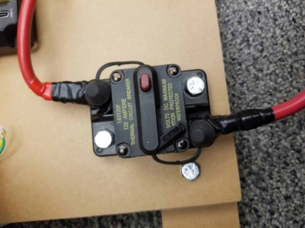

FRC Robot Wiring Walkthrough
============================

.. note::

   Systemcore instructions are being prepared. This page is not yet a complete
   wiring or configuration procedure.

Prepare the Electronics Layout
------------------------------

Start with the :doc:`four-motor drivetrain reference
<intro-to-frc-robot-wiring>` and write down the components on your robot.

* Place the battery, main breaker, power distribution device, Systemcore,
  radio, and motor controllers before cutting cables.
* Leave room to reach connectors, replace the battery, and check indicator
  lights. Keep the main breaker accessible.
* Fasten components using their mounting instructions. Support cables near
  connectors so they do not pull on the terminals.
* Label each motor controller with its side, motor, and CAN ID. Record the
  power distribution channel separately.

Insulate Power Connections
--------------------------

With the battery disconnected, check the main power leads and terminal covers.
Follow the component instructions for terminals, torque, and insulation.
Cover exposed electrical connections before applying power.

   Insulated main breaker terminals.

Connect and Check Motor Cables
------------------------------

Use connectors rated for the wires and circuit. Follow their instructions for
strip length and assembly, and check that each conductor is fully inserted.
Keep bare strands inside the connector and add strain relief to the cable.
For SPARK MAX input and motor-output assignments, use the
:doc:`drivetrain reference <intro-to-frc-robot-wiring>`.

.. figure:: images/how-to-wire-a-simple-robot/motor-power-wago.jpg
   :alt: Lever connector examples, with a red circle marking a conductor that is not fully inserted.
   :width: 500

   The red circle marks a wire that is not fully inserted into the connector.

Route and Secure Cables
-----------------------

Keep wires clear of gears, shafts, belts, and other moving parts. Protect wires
where they pass through the chassis. Secure extra cable without pulling it
against a connector or making future repairs difficult.

.. figure:: images/how-to-wire-a-simple-robot/zipties-kitbot.jpg
   :alt: Drivetrain motor cables secured along the chassis and away from shafts and gears.
   :width: 650

   Motor cables secured along the chassis and clear of moving parts.

See :doc:`/docs/hardware/hardware-basics/wiring-best-practices` for more on
labeling, strain relief, and maintenance access.

Systemcore Connections Still to Complete
----------------------------------------

The Systemcore wiring walkthrough is pending. It needs hardware-revision-specific
power, CAN termination, Smart I/O, radio, and signal-light instructions,
with matching diagrams and a connection checklist.

Start with the `WPILib Systemcore introduction
<https://docs.wpilib.org/en/latest/docs/software/systemcore-info/systemcore-introduction.html>`_.
For controller updates, use the `WPILib Systemcore imaging guide
<https://docs.wpilib.org/en/latest/docs/zero-to-robot/step-3/imaging-your-systemcore.html>`_.
For physical inspection, see
:doc:`/docs/hardware/hardware-basics/preemptive-troubleshooting`.

Next: Inspect the Robot
-----------------------

After completing the wiring using the applicable manufacturer instructions,
follow the :doc:`physical inspection checklist
</docs/hardware/hardware-basics/preemptive-troubleshooting>`. Resolve physical
connection and mounting problems before continuing to software setup.

:doc:`← Wiring reference <intro-to-frc-robot-wiring>`
