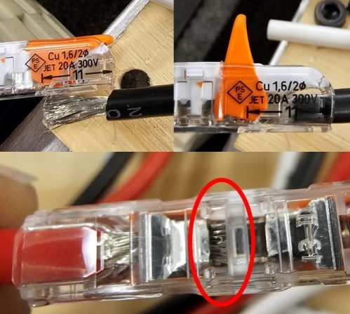
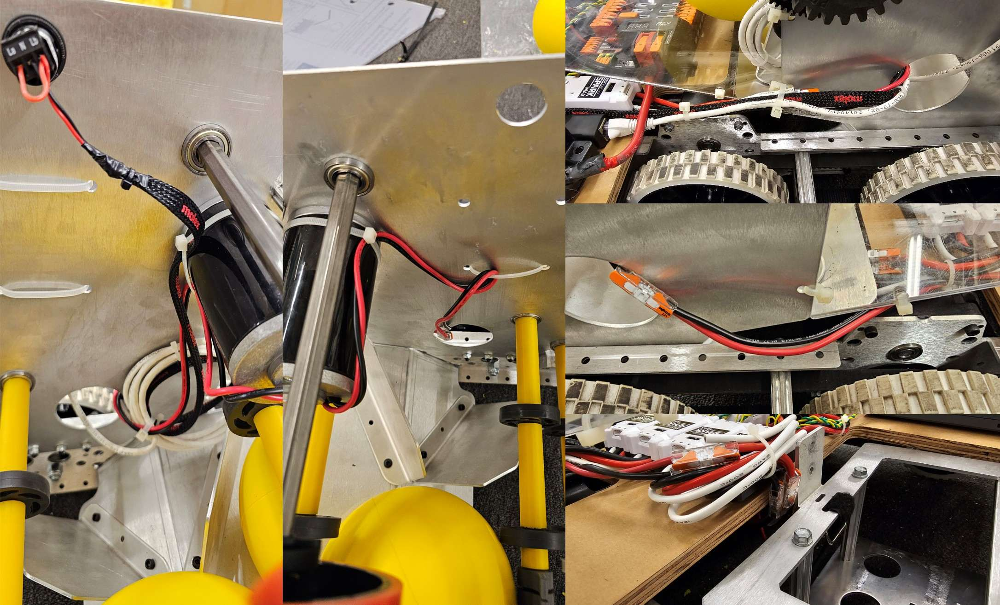

Mounting and Wiring Practices
=============================

.. note::

   For Systemcore connections, use the
   `WPILib wiring guide <{{ wpilib_docs_url }}docs/zero-to-robot/systemcore-wiring.html>`_.

Prepare the Electronics Layout
------------------------------

Start with the `four-motor drivetrain reference in WPILib
<{{ wpilib_docs_url }}docs/zero-to-robot/systemcore-wiring.html>`_ and write down the components on your robot.

* Place the battery, main breaker, power distribution device, Systemcore,
  radio, and motor controllers before cutting cables.
* Leave room to reach connectors, replace the battery, and check indicator
  lights. Keep the main breaker accessible.
* Fasten components using their mounting instructions. Support cables near
  connectors so they do not pull on the terminals.
* Label each motor controller with its side, motor, and CAN ID. Record the
  power distribution channel separately.

Insulate Power Connections
--------------------------

With the battery disconnected, check the main power leads and terminal covers.
Follow the component instructions for terminals, torque, and insulation.
Cover exposed electrical connections before applying power.

.. figure:: images/how-to-wire-a-simple-robot/insulate-REV.jpg
   :alt: Main circuit breaker with both cable terminals covered by insulation.
   :width: 450

   Insulated main breaker terminals.

Connect and Check Motor Cables
------------------------------

Use connectors rated for the wires and circuit. Follow their instructions for
strip length and assembly, and check that each conductor is fully inserted.
Keep bare strands inside the connector and add strain relief to the cable.
For SPARK MAX input and motor-output assignments, use the
`WPILib drivetrain reference <{{ wpilib_docs_url }}docs/zero-to-robot/systemcore-wiring.html>`_.

   The red circle marks a wire that is not fully inserted into the connector.

Route and Secure Cables
-----------------------

Keep wires clear of gears, shafts, belts, and other moving parts. Protect wires
where they pass through the chassis. Secure extra cable without pulling it
against a connector or making future repairs difficult.

   Motor cables secured along the chassis and clear of moving parts.

See :doc:`/docs/hardware/hardware-basics/wiring-best-practices` for more on
labeling, strain relief, and maintenance access.

Continue: Wire Systemcore
-------------------------

With the electronics mounted and cable routes planned, continue to the
`Systemcore wiring guide in WPILib <{{ wpilib_docs_url }}docs/zero-to-robot/systemcore-wiring.html>`_.
It covers the controller connections and links to the inspection checklist
before you move on to software setup.

.. button-link:: {{ wpilib_docs_url }}docs/zero-to-robot/systemcore-wiring.html
   :color: primary

   Continue to Systemcore wiring →

:doc:`← Zero to Robot <../index>`
