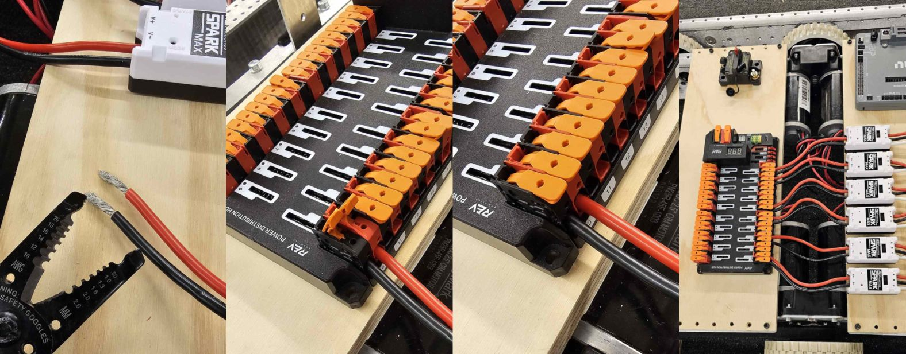
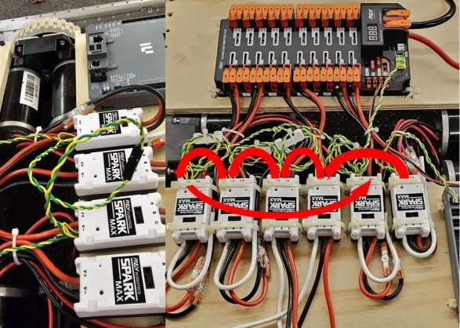
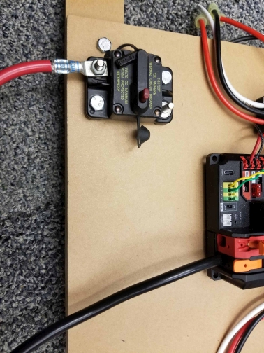
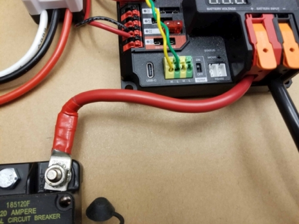
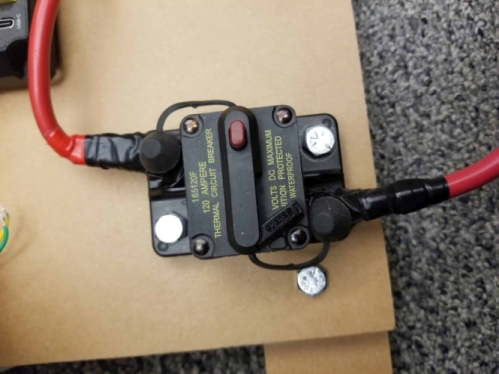
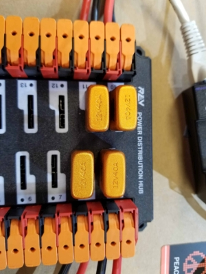
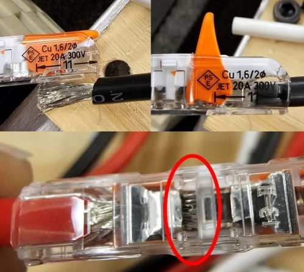
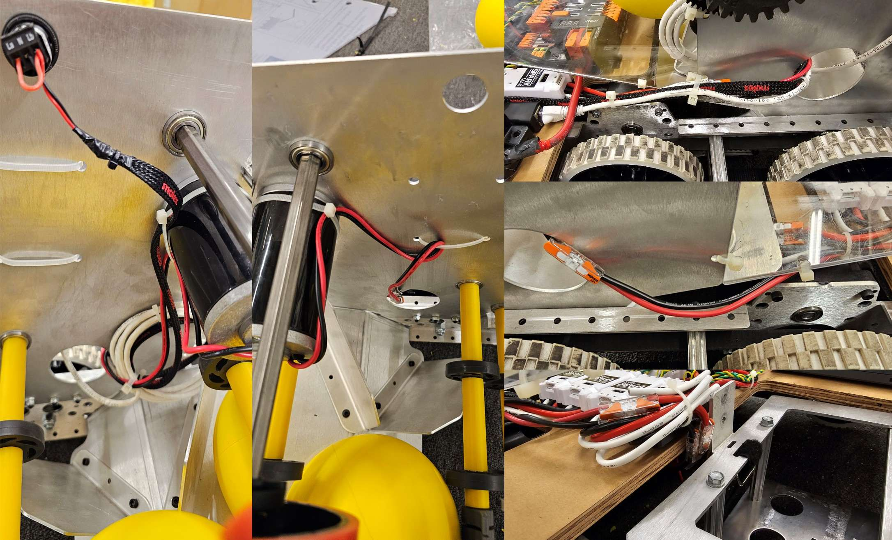

.. include:: <isonum.txt>

Introduction to FRC Robot Wiring
================================

.. note::

   This document details the wiring of a basic electronics board for the Kitbot using components provided in recent Kit of Parts. For a more general reference to wiring which includes other components, see :ref:`docs/zero-to-robot/step-1/basic-robot-wiring:Introduction to FRC Robot Wiring`

Overview
--------

Diagram courtesy of FRC\ |reg| Team 3161 and Stefen Acepcion.

Gather Materials
----------------

Locate the following control system components and tools

- Tools Required:

  - Very small flat head screwdriver (eyeglass repair size)
  - Wire cutters, wire stripper (6, 10, 18, 22 AWGs), and terminal crimper (6AWG terminal) or vice
  - 7/16in (11mm may work if imperial is unavailable) box end wrench or nut driver
  - Additional 7/16in wrench/nut driver or Philips head screw driver
  - Scissors
  - Drill with 1/4in (6mm) bit

Create the Base for the Control System
--------------------------------------

The instructions below heavily rely on the wiring pre-attached to components. The layout provided is designed around using a single board which mounts to the top of the inner rails of the AM14U chassis. Teams are welcome to modify this design and layout but note that additional connectors and wire may be required.

Layout the Core Control System Components
-----------------------------------------

Motor Controller Power
----------------------

Requires: Wire Stripper

Connect each motor controller's input power (red/black side with no white) to the PDHs high current output channels.

.. dropdown:: Details

  1. Strip approximately 1/2 in. (~12mm) of insulation off the red and black power input wires for one SPARK MAX. While the SPARK MAX wire is 12 AWG, because it is high strand count, the 10 AWG size on your wire strippers may work better.
  #. Lift both levers on the PDH for one high current channel until they latch open (the red and black terminals for one channel are indicated by the white label across them below and behind the terminals).
  #. Carefully insert the stripped wire all the way into the terminals and press the latches back down to secure the wires.
  #. Repeat for each controller. Pay attention to which controllers wire to which channel to ensure all controllers will reach without extension.

  .. tip:: If the wire end has become a bit messy and is hard to insert cleanly, a small twist (~ 1/2 a turn) may help. Do not heavily twist the wire, this prevents the terminal inside the PDH from making solid contact with the wire.

Fasten Components
-----------------

Requires: Recloseable fastener, scissors, drill with bit

Cable ties plus reclosable fastener make a great pair for securing robot electronics. The cable ties help hold the components down while the recloseable fastener helps hold them in place. The instructions below describe securing your electronics with this method, though you may choose to use hardware (nuts and bolts) to secure some components instead.

CAN Bus connections - SPARK MAXes
---------------------------------

Requires: SPARK MAX CAN Cables and Cable retention clips (found in SPARK MAX boxes)

Attach Robot Side Battery Connector
-----------------------------------

Requires: Battery Connector, 1x 6 AWG (16 :math:`mm^2`) terminal lugs, 7/16in (11mm) Box end

Attach the red wire from the battery connector to the main breaker using a terminal lug and attach the black side to the power input of the PDH.

.. dropdown:: Details

  1. Attach terminal lug to positive (red) wire of battery connector. Strip .75in off the black wire.
  #. Lift the lever above the black main power input terminal on the PDH until it clicks into place. Insert the wire. Pull the lever down to secure the wire.
  #. Using a 7/16in (11mm) box end wrench, remove the nut on the "Batt" side of the main breaker and secure the positive terminal of the battery connector

Wire Breaker to Power Distribution
----------------------------------

Requires: 6 AWG (16 :math:`mm^2`) red wire, 1x 6 AWG (16 :math:`mm^2`) terminal lugs, 7/16in (11mm) wrench

Connect 6AWG wire between the second terminal of the 120A circuit breaker and the red power input of the PDH

.. dropdown:: Details

  1. Secure one terminal lug to the end of the 6 AWG (16 :math:`mm^2`) red wire.
  #. Using the 7/16in (11mm) wrench, remove the nut from the "AUX" side of the 120A main breaker and place the terminal over the stud.
  #. Loosely secure the nut (you may wish to remove it shortly to cut and strip the other end of the wire). Measure out the length of wire required to reach the positive terminal of the PDH.
  #. Cut and strip the other end of the red wire.
  #. Using the 7/16" (11 mm) wrench, secure the wire to the "AUX" side of the 120A main breaker.
  #. Lift the lever on the positive (red) input terminal of the PDH, insert the wire, then close the terminal.

Insulate power connections
--------------------------

Requires: Electrical tape

Using electrical tape, insulate the two connections to the 120A breaker.

Radio Power
-----------

Requires: Vivid Hosting PoE adapter cable

Connect the PoE adapter cable to a non-switchable fused channel (20-22) with a 10A fuse to power the VH-109 radio.

Circuit Breakers
----------------

Requires: 6x 40A circuit breakers

Insert 40-amp Circuit Breakers into the positions on the PDH corresponding with the Wago connectors the motor controllers are connected to. Note that the white graphic indicates which breakers are associated with which terminal pairs.

Pause
-----

If you are preparing the wiring outside the robot, pause at this point. The remaining wiring must be completed after the board is installed on the robot.

Ethernet Cable
--------------

Requires: 1x Ethernet cable

Robot Signal Light
------------------

Requires: Wire stripper, 2 pin cable with Molex jacket from Molex box, Robot Signal Light, 18 AWG (1 :math:`mm^2`) red wire, very small flat screwdriver

Motor Power
-----------

Requires: Wire stripper, 14x Wago 221 terminals, 12AWG wire

For each motor, use the Wago 221 terminals to connect the output of the motor controller to the motor. A recommended arrangement is to use the isolated SPARK MAX for the feeder motor, the other single SPARK MAX for the intake/launcher, and the four grouped SPARK MAXes for the Drivetrain, split into pairs for each side. Note that for the intake/launcher motor, an additional intermediate connection is recommended in order to have the necessary length to route the wire safely along robot elements.

.. dropdown:: Details

  1. Using the print on the side of the 221 connector (upper left image) as a guide, strip 11mm from the end of one wire.
  #. Lift the orange lever of the 221 connector until it latches up, then insert the wire fully into the terminal. Flip the lever back down.
  #. Using the inspection window on the bottom of the connector, check that the wire is fully inserted by verifying the wire is visible beyond the metal funnel of the terminal.
  #. Repeat this process to connect each drivetrain CIM motor and the feeder motor directly to a motor controller output, red-to-red, black-to-black.
  #. For the intake/launcher motor, it is recommend to use 12AWG wire as an extension. Attach 12AWG wire to the motor wires, then run the wire along robot components until you reach the motor contoller. Cut and strip the 12AWG extension wire and secure to the motor controller output.

STOP
----

.. danger:: Before plugging in the battery, make sure all connections have been made with the proper polarity. Ideally have someone that did not wire the robot check to make sure all connections are correct.

- Start with the battery and verify that the red wire is connected to the positive terminal
- Check that the red wire passes through the main breaker and to the + terminal of the PDP and that the black wire travels directly to the - terminal.
- For each motor controller, verify that the red wire goes from the red PDP terminal to the V+ terminal on the motor controller (not M+!!!!)
- For each non-motor controller device, verify that the red wire runs from a red terminal on the PD and connects to a red terminal or terminal labeled + or V on the component.

.. tip:: It is also recommended to put the robot on blocks so the wheels are off the ground before proceeding. This will prevent any unexpected movement from becoming dangerous.

Manage Wires
------------

Requires: Zip ties

.. tip:: Now may be a good time to add a few zip ties to manage some of the wires before proceeding. This will help keep the robot wiring neat and protected. Secure wires to robot components to make them less likely to be caught and pulled by other robots, or when performing robot maintenance. Make sure wires are not pulled too tight (don't put any strain on connection points) and that they do not have enough slack to reach moving components (such as drivetrain belts) while the robot is operating.

.. warning:: If you are passing wires through any of the openings in the KitBot sheet metal, it is recommended to shield the edge of the metal, the wires passing through, or both, to avoid wire damage. Electrical tape or Gaffers tape work well for this purpose.

Connect Battery
---------------

Connect the battery to the robot side of the Anderson connector. Power on the robot by moving the lever on the top of the 120A main breaker into the ridge on the top of the housing.

If stuff blinks, you probably did it right. If you hear any clicking, or see any smoke, power the system off immediately, clicking is likely the sound of circuit breakers tripping.

Before moving on, if using SPARK MAX controllers, there is one more configuration step to complete. The SPARK MAX motor controllers are configured to control a brushless motor by default. You can verify this by checking that the light on the controller is blinking either cyan or magenta (indicating brushless brake or brushless coast respectively). To change to brushed mode, press and hold the mode button for 3-4 seconds until the status LED changes color. The LED should change to either blue or yellow, indicating that the controller is in brushed mode (brake or coast respectively). To change the brake or coast mode, which controls how quickly the motor slows down when a neutral signal is applied, press the mode button briefly.

.. tip:: For more information on the SPARK MAX motor controllers, including how to test your motors/controllers without writing any code by using the REV Hardware Client, see the `SPARK MAX Quickstart guide <https://docs.revrobotics.com/brushless/spark-max/gs>`__.

.. note:: Systemcore scope

   The wording above is retained from the upstream article. Controller-specific
   material and illustrations that do not apply to this site's Systemcore scope
   are excluded rather than relabeled. Use the
   `Systemcore wiring guide <{{ wpilib_docs_url }}docs/zero-to-robot/systemcore-wiring.html>`_
   for the installed revision's connection requirements.

Source: `WPILib stable: Introduction to FRC Robot Wiring
<https://docs.wpilib.org/en/stable/docs/zero-to-robot/step-1/intro-to-frc-robot-wiring.html>`__,
`CC BY 4.0 <https://creativecommons.org/licenses/by/4.0/>`__.
